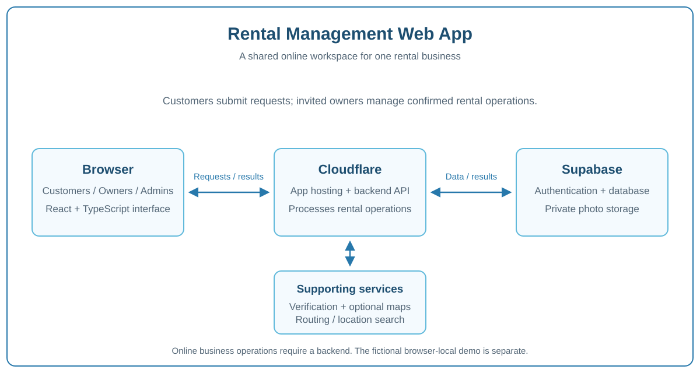

# How I Built the Rental Management Web App

I built this app around the daily work of a small rental business: knowing what is available, keeping customer details together, following a rental from request to return, and keeping money and documents consistent.

## Starting with the workflow

I mapped the actions a customer and a business owner need to take. Customers need a clear way to request a rental. Owners need to review availability and charges before confirming it. Property stays and monthly agreements need their own rental choices and follow-up actions.

## Building the interface

I used React and TypeScript with Vite for the browser interface. The workspace brings together a calendar, forms, inventory, reports and settings. I kept the customer request flow separate from the invited-owner workspace and made the layout usable across common screen sizes.

## Connecting the online app

Cloudflare Workers hosts the app and handles backend requests. Supabase provides authentication, the shared database and private image storage. Optional mapping services support venue search and delivery estimates. The app checks changes on the backend before confirming them.

## Keeping records consistent

Bookings, stock, operational handoffs, payments and issued documents describe different parts of the same rental. I kept those responsibilities distinct so a later change does not silently rewrite an issued document. Shared saves recheck the current state, and recoverable errors preserve the user's work.

## Checking the result

I used automated checks for rental calculations, data consistency, access boundaries, forms and packaged application behavior. I also kept practical checks such as printing, touch interaction and installed-app behavior separate, because an automated test cannot establish every real-device result.

## Making it configurable

Business identity, appearance, catalog items and rental options can be configured for an independent installation. The public demo uses fictional browser-local data; the online source product is set up with the buyer's own services.

For a product walkthrough, visit the [Wiki](https://github.com/David-debug2/Rental-Management-Web-App-docs/wiki) or [try the demo](https://demo-rental.davidalea.space/). For the development source and complete setup documentation, visit [Project David on Ko-fi](https://ko-fi.com/projectdavid).
