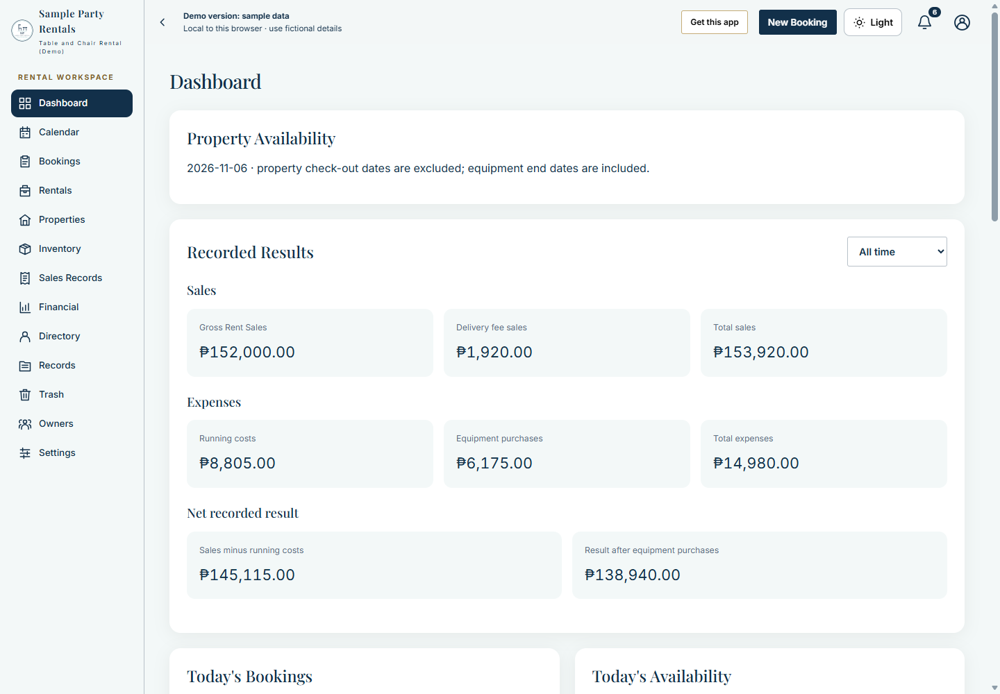
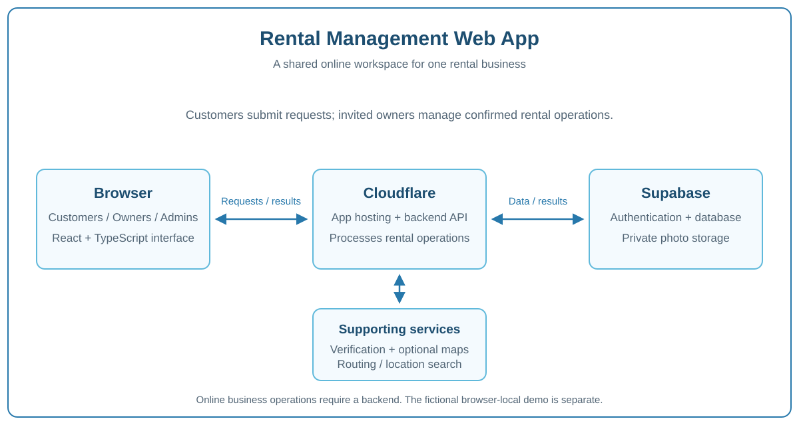

# Rental Management Web App

A rental-management workspace for small businesses that need a clearer way to manage bookings, availability, customer requests and records. It supports event equipment, property stays and monthly rental workflows in one configurable app.

**[Try the live demo](https://demo-rental.davidalea.space/)** · **[Read the user Wiki](https://github.com/David-debug2/Rental-Management-Web-App-docs/wiki)** · **[Get the source code on Ko-fi](https://ko-fi.com/projectdavid)**

The demo uses fictional records stored in your browser and simulated routing. Changes there do not affect a real rental business. A separately configured online installation shares records between invited users.

## See the app

*Actual demo screenshot with fictional data. [Browse the illustrated tour](Screenshots.md) for the calendar, inventory, booking form, receipts, customer page and mobile view.*

## Who it is for

- Event and equipment rental businesses managing items, delivery and returns.
- Property operators managing units, stays or monthly agreements.
- Small teams that need a shared calendar, customer requests, payment records and printable documents.
- Developers or business owners who want a customizable source-code product for their own deployment.

## How it works

Customers open the public booking page, choose available rental options, enter their details and submit a request. Requests remain pending until an Owner reviews them. The owner workspace handles approved bookings, inventory, handoffs, payments, receipts and reports. Administrators also manage invited accounts and service settings.

## How to use it

1. Explore the demo and choose the rental options relevant to your business.
2. In an independently configured installation, sign in using an invited account.
3. Configure business details, catalog stock/prices and any property units or monthly policies.
4. Share the installation's customer booking link, or create bookings from the workspace.
5. Review requests, confirm availability and charges, then record dispatch/check-in, returns/check-out and payments.
6. Issue and print documents, review reports and keep your records current.

See the [visual tour](Screenshots.md), [Getting Started](https://github.com/David-debug2/Rental-Management-Web-App-docs/wiki/Getting-Started) and [Rental Workflows](https://github.com/David-debug2/Rental-Management-Web-App-docs/wiki/Rental-Workflows) for a practical overview.

## Main capabilities

Calendar and bookings · Inventory and photos · Customer requests · Property/monthly rentals · Delivery estimates · Payments and receipts · Expenses and reports · Customer history · Workbook export · Recoverable records · Business appearance settings · Installed-app support

Availability and pricing depend on the selected rental type and saved configuration. Requests are not confirmed bookings. A Facebook profile URL is contact information, not verified identity. Online business operations require the configured backend and an internet connection.

## Architecture

The browser runs the React/TypeScript interface. Cloudflare serves the app and backend; Supabase provides authentication, database and private storage. Mapping and verification services support the relevant workflows. See [Architecture](https://github.com/David-debug2/Rental-Management-Web-App-docs/wiki/Architecture).

## About this repository

This repository and Wiki contain public product documentation. [How I Built It](How-I-Built-It.md) explains the general development approach. Detailed installation guides, implementation source and the complete architecture references are supplied with the commercial source package.

To obtain the source code, visit [Project David's Ko-fi shop](https://ko-fi.com/projectdavid). Review the [purchase terms](Purchase-Terms.md) before buying. Hosting, setup, customization, support and updates are included only where expressly stated in your order.

Copyright David Alea, trading as Project David. See the [documentation notice](Documentation-Notice.md). Public documentation does not grant a license to the paid application source.

## More cards and settings

Explore the [Settings Showcase](Settings-Showcase.md) for identity, appearance, numbering, delivery, rental options and update cards. The [Workspace Cards tour](Workspace-Cards.md) shows all thirteen tabs at a reduced scale, including cards below the first screen.
