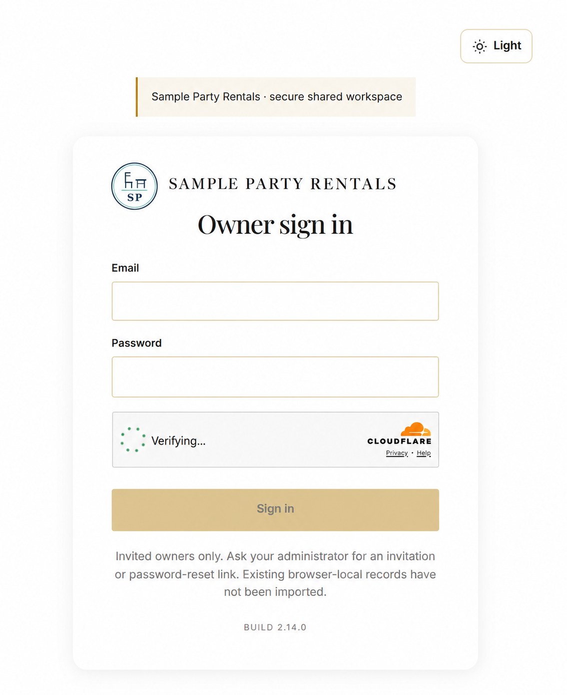
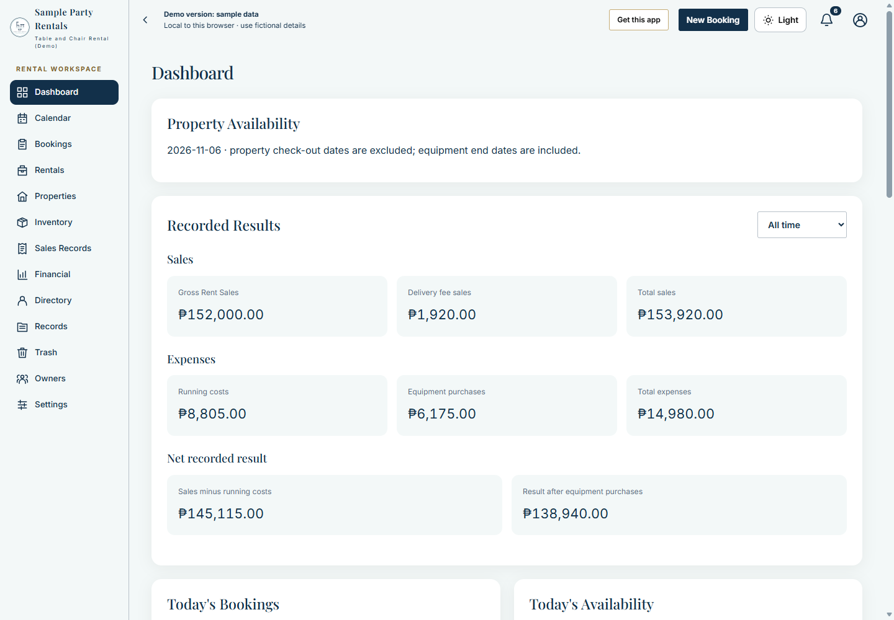
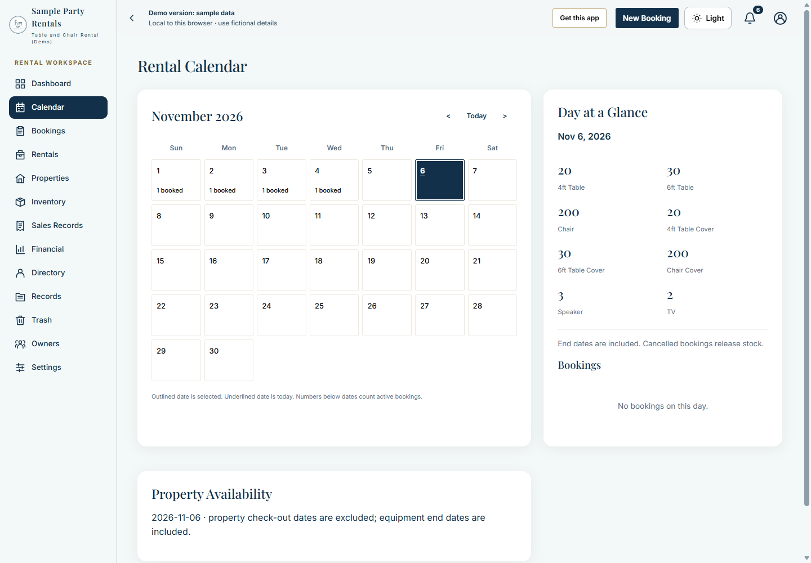
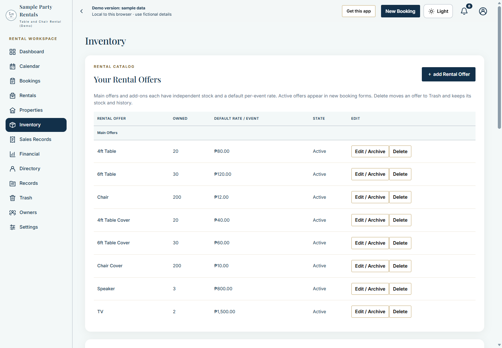
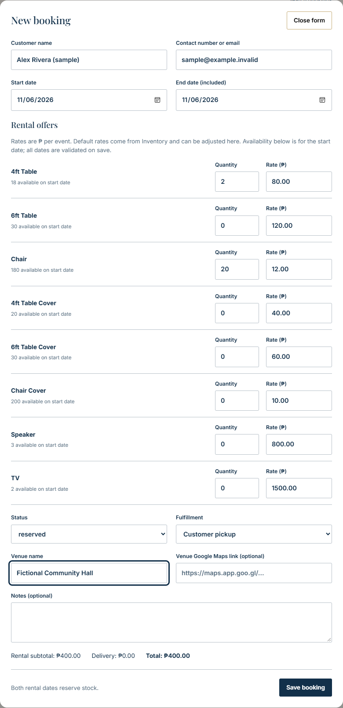
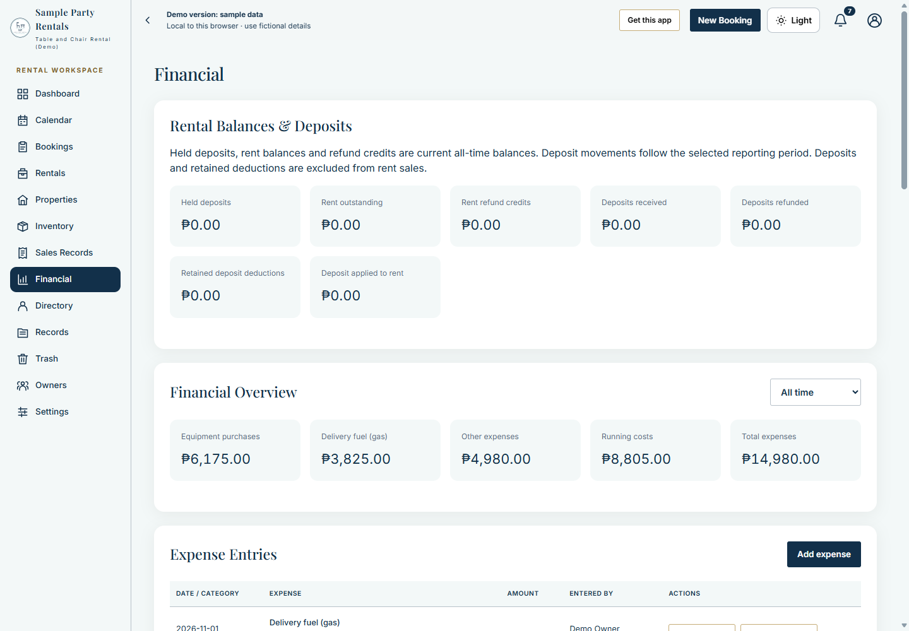
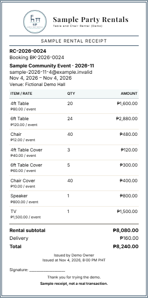
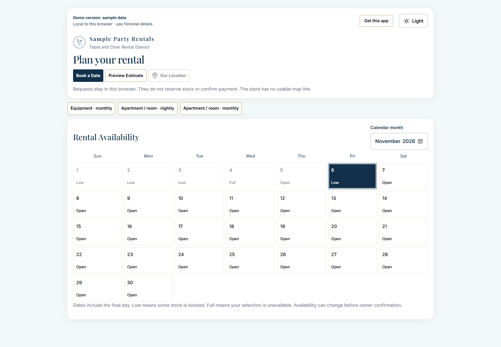
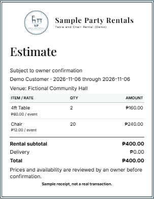
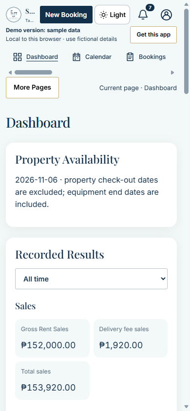

# A visual tour of the rental app

[Try the demo](https://demo-rental.davidalea.space/) · [Read the Wiki](https://github.com/David-debug2/Rental-Management-Web-App-docs/wiki) · [Get the source on Ko-fi](https://ko-fi.com/projectdavid)

Screenshots use fictional Sample Party Rentals demo data. Names, contact details, dates, quantities and amounts inside the screens are illustrative. The sign-in image is a separately edited illustration; the public demo uses Enter demo without a password. Your own installation uses your business branding and configured services.

Choose a screen: [Owner sign-in](#owner-sign-in) · [Dashboard](#dashboard) · [Rental calendar](#calendar) · [Inventory](#inventory) · [New booking](#booking-form) · [Financial overview](#financial) · [Saved sample receipt](#receipt) · [Customer booking page](#customer-booking) · [Customer estimate preview](#customer-estimate) · [Mobile workspace](#mobile-workspace)

## Owner sign-in

Edited illustration based on the owner-supplied sign-in image. Only the business branding was requested to be changed to Sample Party Rentals. The verification widget is shown in progress; this image is not evidence of a completed login or the public demo login flow.

## Dashboard

Recorded sales, expenses and availability in the owner workspace. All figures shown belong to fictional demo records, not a business performance claim.

## Rental calendar

The month view and Day at a Glance help an owner inspect bookings and item availability. Equipment booking end dates are included; property checkout rules differ.

## Inventory

Example offers with owned quantities and per-event prices. These are demonstration rates, not prices charged by Project David or a live rental business.

## New booking

A fictional pickup draft with a sample customer, two tables and twenty chairs. The form shows the chosen quantities, rates, venue and estimate before saving.

## Financial overview

Recorded expense categories are shown separately. Deposits and rental balances have their own summaries; these values are not a bank balance or audited profit.

## Saved sample receipt

An issued document can be opened for printing. The visible sample-receipt warning is retained. This is an illustration, not proof of tax certification or printer acceptance.

## Customer booking page

Customers can browse the public availability calendar and open the request form. Requests remain subject to owner review; the demo stores them only in the browser.

## Customer estimate preview

The fictional request totals four hundred pesos for pickup. Previewing is not a payment, stock reservation or issued receipt.

## Mobile workspace

A narrow browser view shows the compact header, horizontal navigation and More Pages control. This screenshot does not establish testing on every phone.

## Try the same journey

1. Open the demo and choose **Enter demo** to explore the workspace, or **Try customer booking** for the customer view.
2. Start with Inventory and Calendar, then open New Booking to review the fields. Use fictional details only.
3. Visit Sales Records to inspect a saved sample receipt, then Financial to review sample expenses.
4. On the customer page choose Book a Date, select quantities and pickup/delivery, then Preview Estimate before deciding whether to submit a fictional request.

The browser-local demo is separate from an independently configured online installation. Provider-dependent features, available rental options and appearance depend on configuration. Full setup guides and the development source accompany the [commercial source product](https://ko-fi.com/projectdavid). See [purchase terms](Purchase-Terms.md).

## Explore every card

See the [Settings Showcase](Settings-Showcase.md) for readable card close-ups and the [Workspace Cards tour](Workspace-Cards.md) for zoomed-out views of every tab.
