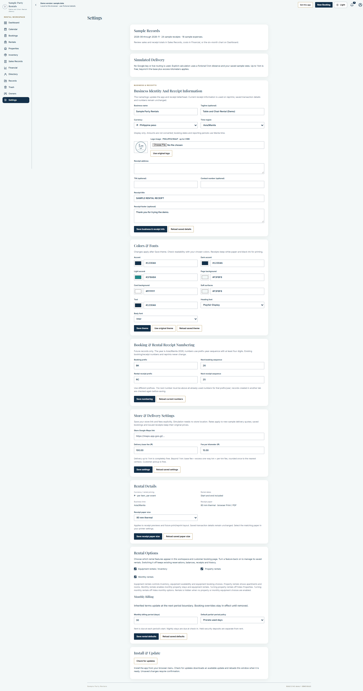
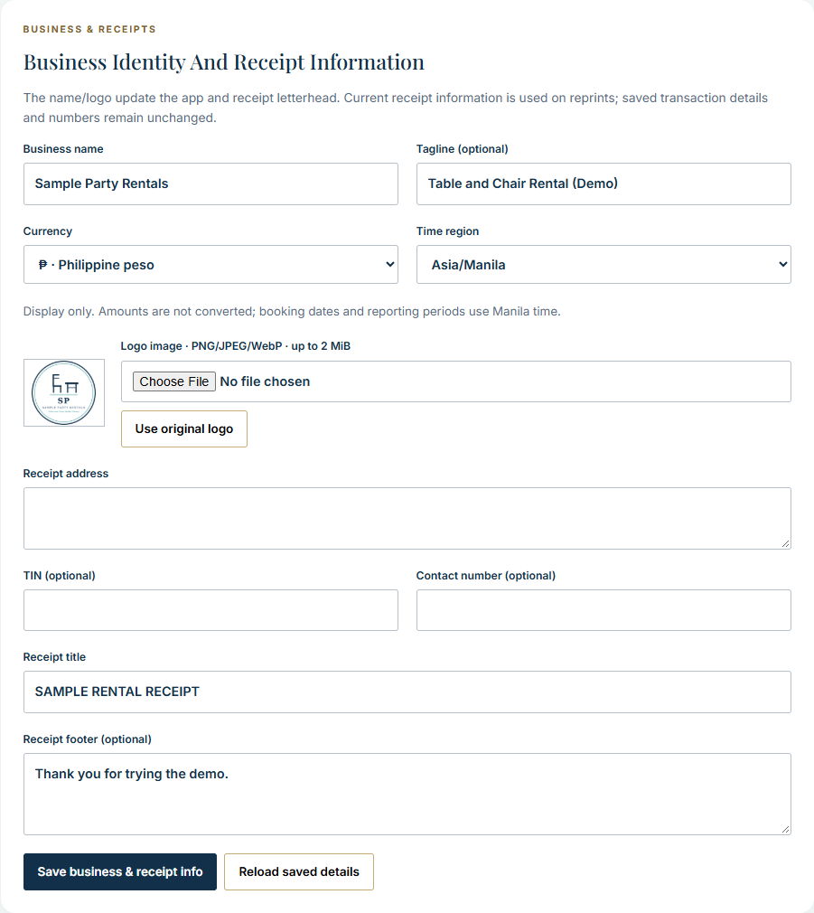
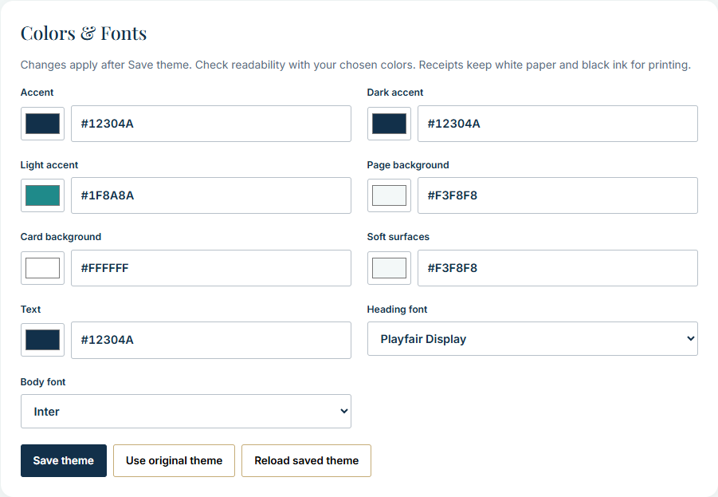
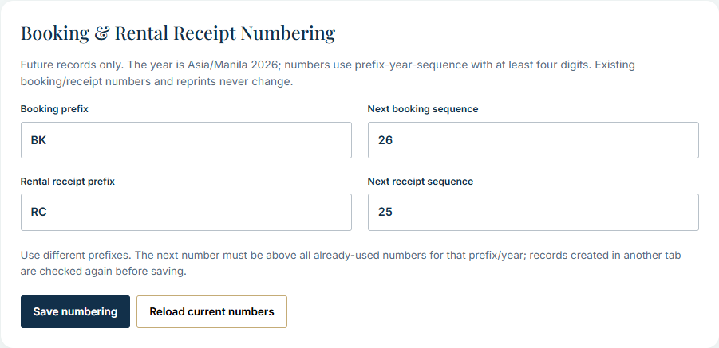
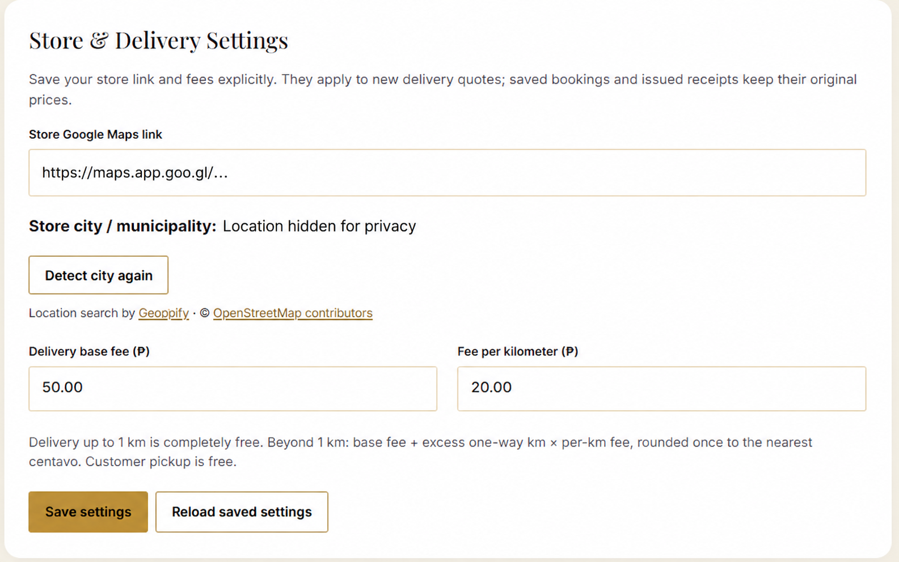
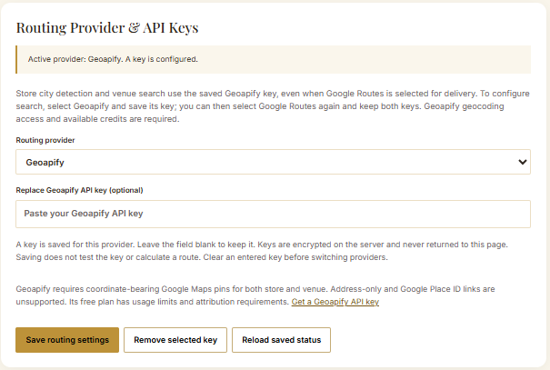
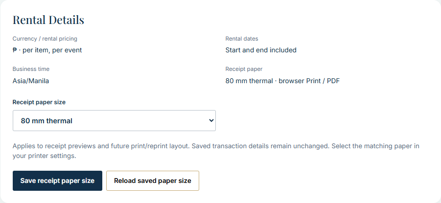
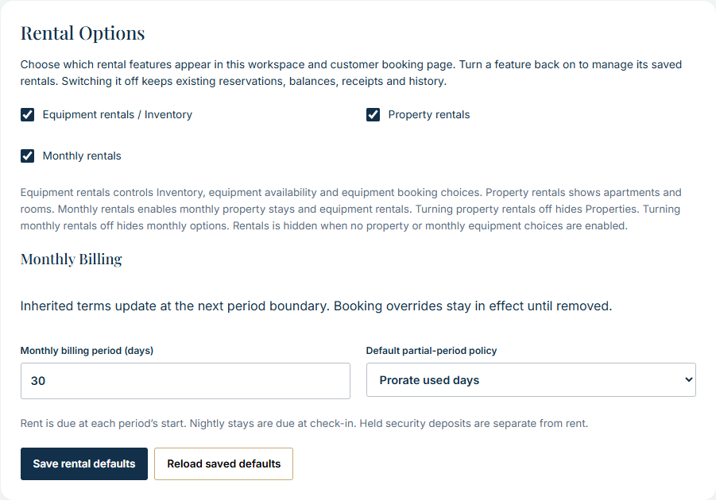
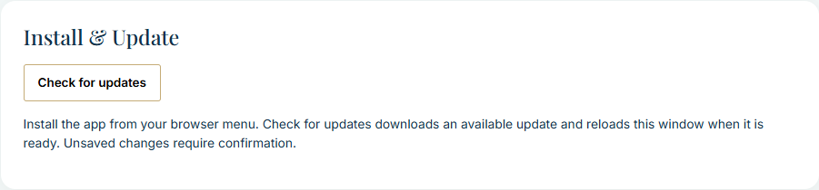
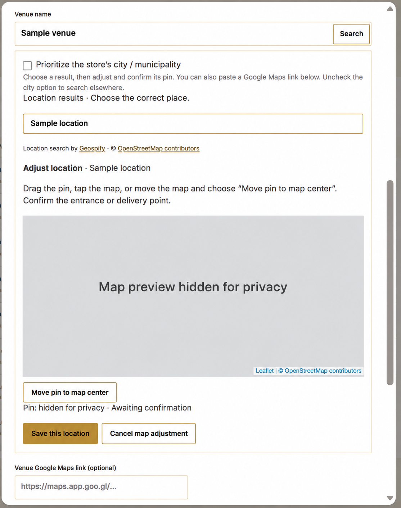

# Settings showcase

Configure the app around your business identity, rental model and daily work. These cards bring the main preferences into the workspace without changing source code for ordinary configuration.

Actual demo captures use fictional browser-local records. Supplied online-setting references are identified and private location details are hidden. Images are product illustrations, not evidence of a new live provider call, configured account or successful route. Click an image to open its full resolution.

[Workspace card tour](Workspace-Cards.md) · [Try the demo](https://demo-rental.davidalea.space/) · [Get the source on Ko-fi](https://ko-fi.com/projectdavid)

## All settings cards at a glance

The overview is zoomed out to show the full card stack. Use the close-ups below for labels and controls. Sample Records and Simulated Delivery belong to the demo; live provider controls are shown in the supplied references.

## Business identity and receipts

**Make the workspace your own.** Set the business name, tagline, logo and receipt letterhead information from one card. Display currency and time-region choices do not convert stored amounts or change the app's accounting rules. This screenshot uses fictional demo identity and blank address, tax and contact fields.

## Colors and fonts

**Match your business appearance.** Choose the main colors, surfaces and allowlisted fonts, then save the theme explicitly. Check readability with your choices; printed receipts retain their monochrome presentation.

## Future booking and receipt numbering

**Keep new documents consistent.** Configure booking/receipt prefixes and the next sequences for future records. Previously issued numbers and reprints are retained. Visible example sequences belong to the fictional demo.

## Store and delivery settings

**Set a store location and delivery pricing.** The supplied card shows a store Maps-link field, city detection, base fee and per-kilometre fee. Delivery through the first kilometre is free under the included rule. The pictured amounts are configuration examples, not a product price or rental quotation. City and Maps-link values in this illustration are hidden for privacy.

## Routing provider and API keys

**Choose a supported routing provider.** The supplied reference shows provider selection and an empty replacement-key field. No API key is visible. Saving a key does not prove that routing, billing or quota is ready; provider services require the installation's own configuration. This is an online-settings reference, not a feature activated in the browser-local demo.

## Receipt paper and rental details

**Prepare documents for your printer.** Review the rental display assumptions and select the intended receipt-paper width. Test the actual printer and driver; a screenshot does not establish physical print acceptance.

## Rental options and monthly billing

**Show the workflows your business needs.** Enable equipment, property and monthly rental choices and review the monthly period/partial-period settings. Disabled options retain existing records and obligations; turn them back on to manage the saved rentals.

## Installation and updates

**Keep the installed interface current.** Check for a deployed update and apply the offered reload explicitly. Unsaved work must be handled before reloading. An installed interface still needs its configured backend for online business operations.

## Venue search and location confirmation

**Confirm the entrance or delivery point.** The supplied reference shows search results, map adjustment and Use/Save this location actions. The city labels, map detail and numeric pin are hidden for privacy. It illustrates the workflow rather than a newly calculated or verified route.

## What to review before real use

Save each relevant section, confirm the business/receipt identity, set actual stock and rates, and check the selected rental options. Keep provider keys private and use only your own authorized services. Hosting, provider accounts, setup and support are included only when expressly promised in your order.

For the development source and complete independent setup guides, visit [Project David on Ko-fi](https://ko-fi.com/projectdavid). Read the [purchase terms](Purchase-Terms.md) before buying.
