# Workspace cards - every tab

See the full workspace, including cards below the first screen. These captures use a reduced display scale and include the entire tab content, so you can open an image to inspect the details.

All records are fictional demo examples. Some tabs intentionally show an empty state because that type of record has not been created. Rental options and access level affect the screens in an independently configured installation.

[Settings showcase](Settings-Showcase.md) · [Original screenshot tour](Screenshots.md) · [Try the demo](https://demo-rental.davidalea.space/)

| Tab | What to look for |
| --- | --- |
| Dashboard | Review the business at a glance |
| Calendar | Plan around availability |
| Bookings | Keep customer equipment bookings together |
| Rentals | Follow property and monthly agreements |
| Properties | Organize locations, units and maintenance |
| Inventory | See more than the catalog |
| Sales Records | Connect sales summaries with issued documents |
| Financial | Separate costs, balances and retained history |
| Directory | Find a customer's rental history |
| Records | Review and export business records |
| Trash | Recover eligible deleted records |
| Owners | Understand the access area |
| Settings | Configure the app for your business |

## Dashboard

**Review the business at a glance.** Recorded Results separates sales, running costs and equipment purchases. Today's Bookings, Today's Availability, summary shortcuts, Top Rented Items and Sales vs Expenses help you decide what to review next. Property Availability appears when the relevant rental options are enabled.

[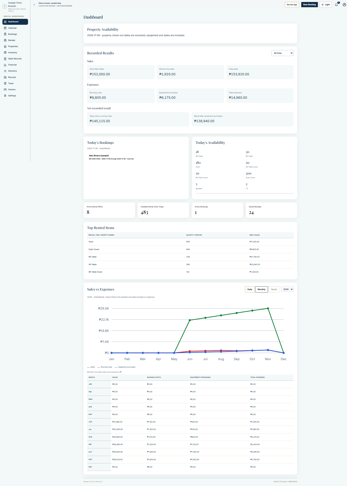](assets/screenshots/dashboard-overview.png)

## Calendar

**Plan around availability.** The month card sits beside Day at a Glance and selected-day bookings. Property availability appears below where enabled. Equipment reservations and property checkout dates follow their respective rental rules.

[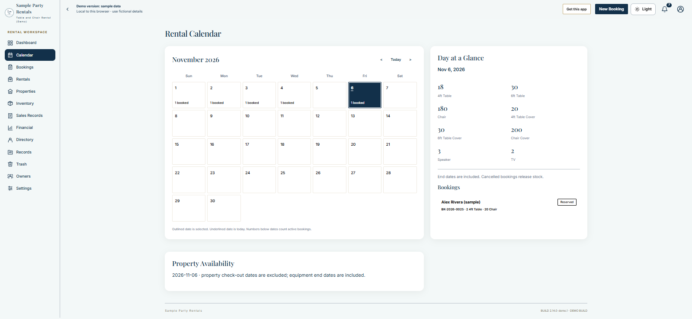](assets/screenshots/calendar-overview.png)

## Bookings

**Keep customer equipment bookings together.** The booking list brings customer names, event dates, items, status and total into one view, with search and status filters. Open a booking for its payment, document and handoff actions.

[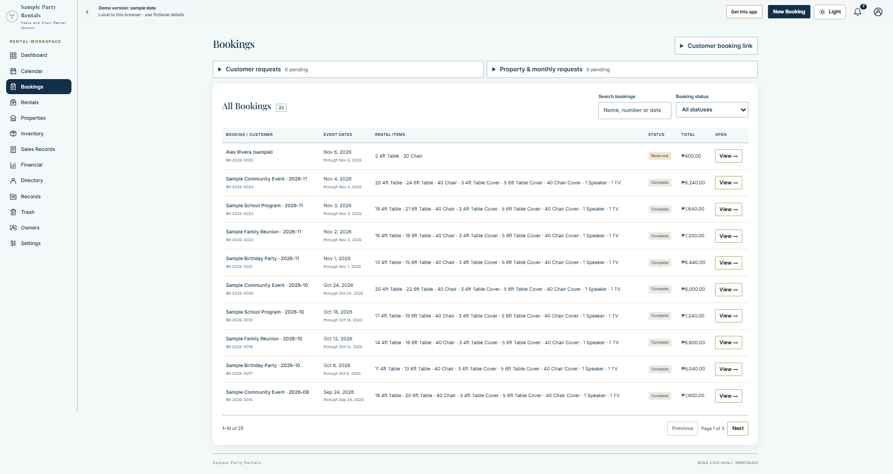](assets/screenshots/bookings-overview.png)

## Rentals

**Follow property and monthly agreements.** Property & Monthly Bookings is the starting point for enabled longer-running rental workflows. An empty list means no agreements are saved in this fictional demo; it does not imply a missing feature.

[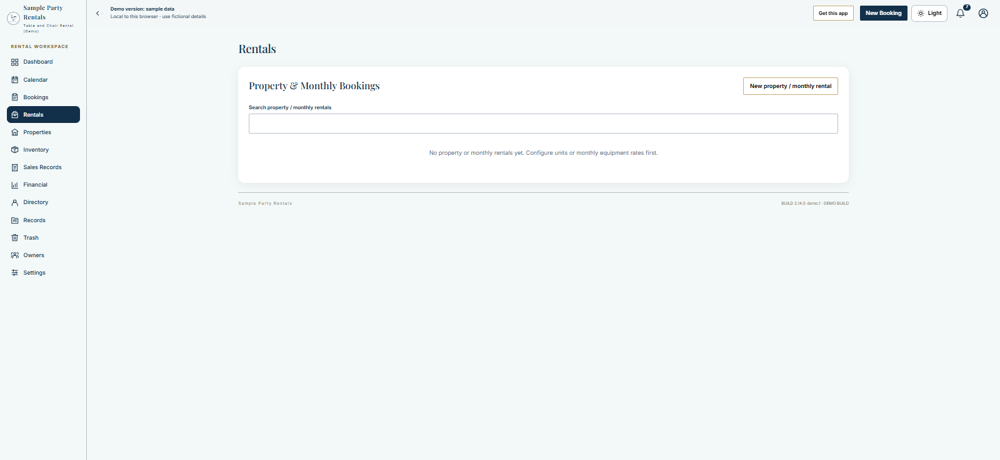](assets/screenshots/rentals-overview.png)

## Properties

**Organize locations, units and maintenance.** Separate cards cover Properties, Apartments & Rooms and Active Unit Maintenance. Set up the relevant units and rates before accepting property requests. The pictured empty state contains no real property addresses.

[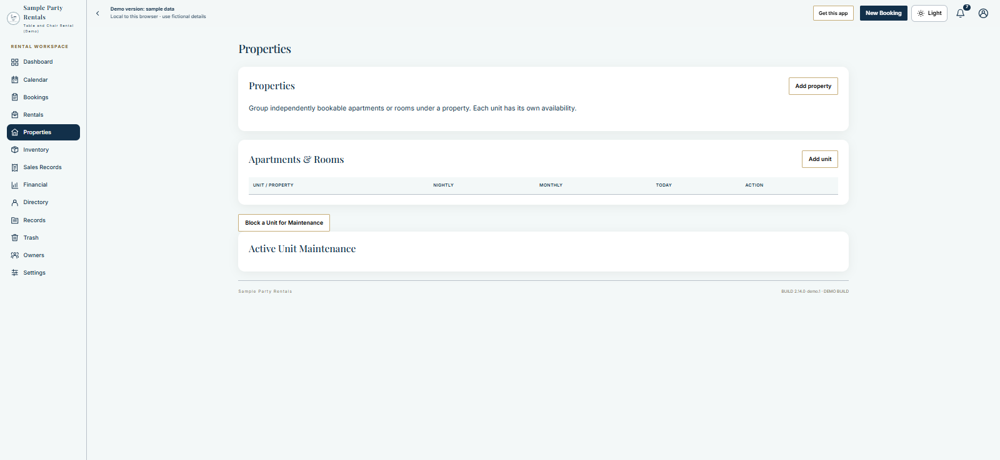](assets/screenshots/properties-overview.png)

## Inventory

**See more than the catalog.** Your Rental Offers is followed by Today's Inventory Availability, Damaged and Maintenance Stock, Stock Block History, Monthly Equipment Pricing and Inventory Change History. The overview includes the cards below the first screen.

[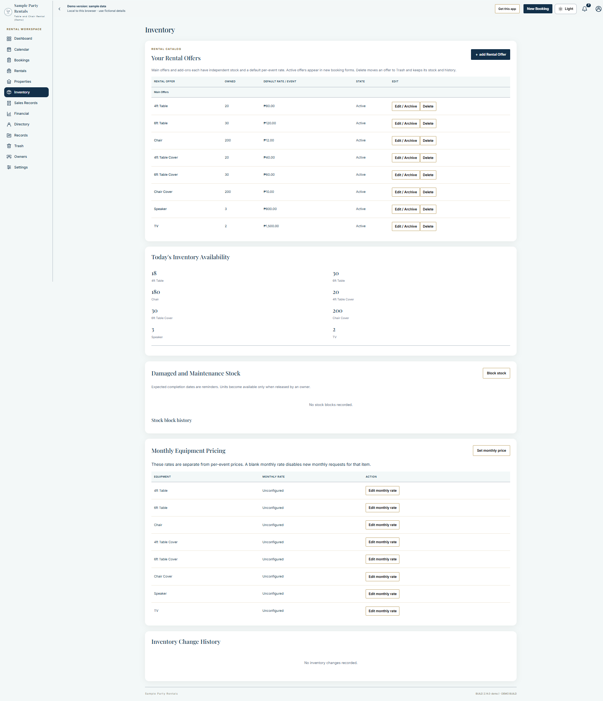](assets/screenshots/inventory-overview.png)

## Sales Records

**Connect sales summaries with issued documents.** Sales Overview and item-level rent sales sit above Receipt Overview and Saved Receipts. Search and View / print help find a document without confusing current payment status with its original issued snapshot.

[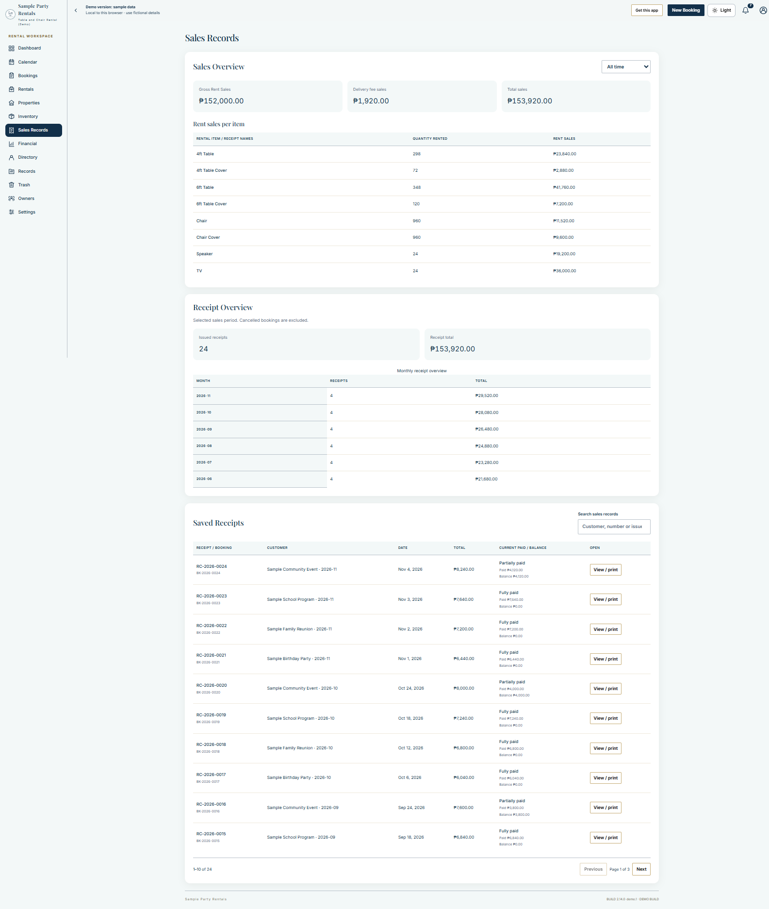](assets/screenshots/sales-records-overview.png)

## Financial

**Separate costs, balances and retained history.** Rental Balances & Deposits, Financial Overview, Expense Entries, Latest Equipment Unit Costs and Expense Change History appear together. Recorded results are management figures, not a bank balance or audited profit.

[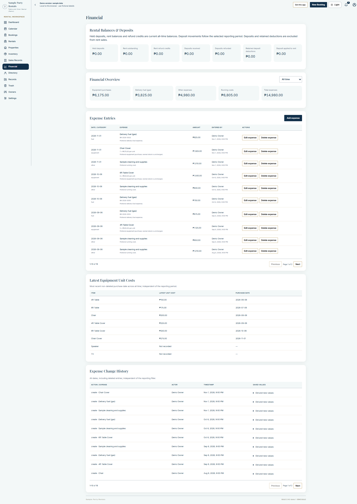](assets/screenshots/financial-overview.png)

## Directory

**Find a customer's rental history.** Customer Directory groups the fictional customer records for searching and opening their history. Demo names and contact values are examples only.

[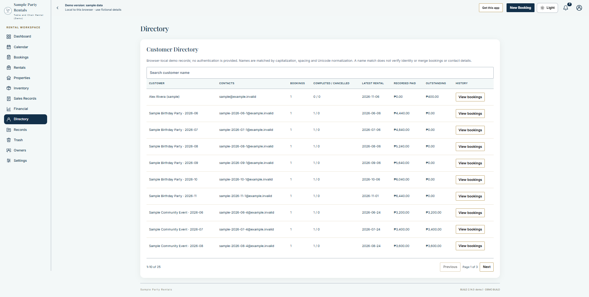](assets/screenshots/directory-overview.png)

## Records

**Review and export business records.** Record Spreadsheets and Download Records provide the records/export view. Exported business data must be handled privately; the public documentation includes no workbook of real records.

[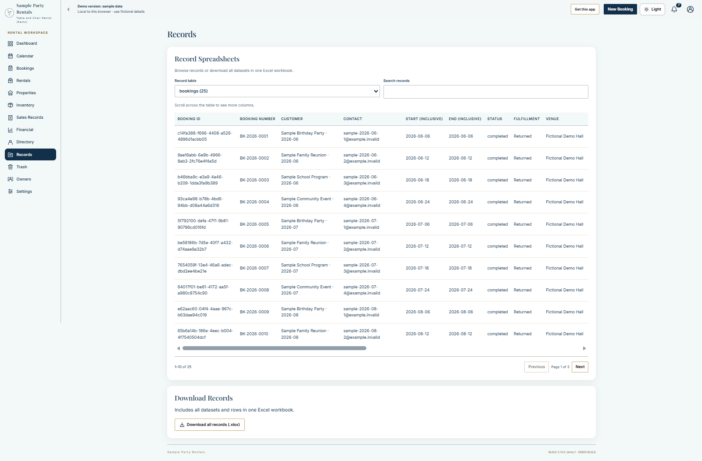](assets/screenshots/records-overview.png)

## Trash

**Recover eligible deleted records.** Deleted Records and Trash History keep recovery and its record trail together. An empty Trash view is shown here. Deletion remains subject to outstanding physical and financial obligations.

[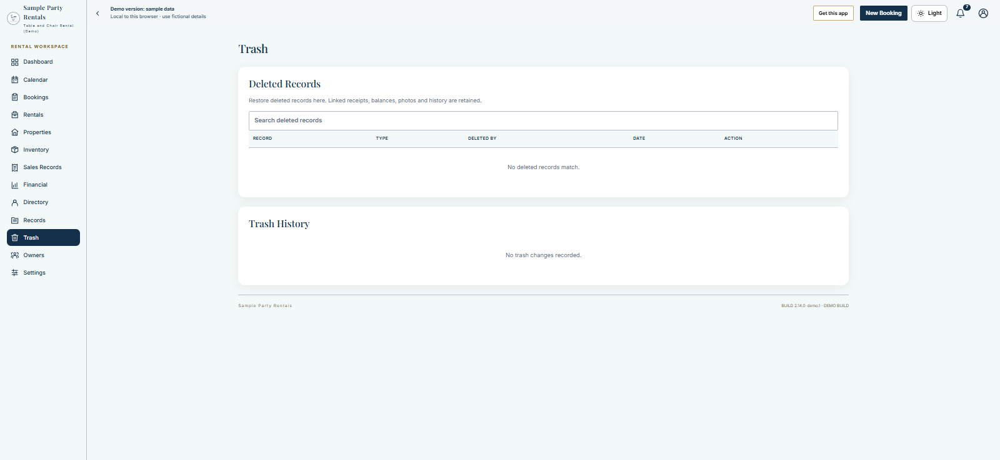](assets/screenshots/trash-overview.png)

## Owners

**Understand the access area.** The public demo shows its fictional Demo Owner and demo link controls, without a password or shared account. An online installation uses invited Owner/Administrator access and its own administrator controls; this demo capture does not depict live account setup.

[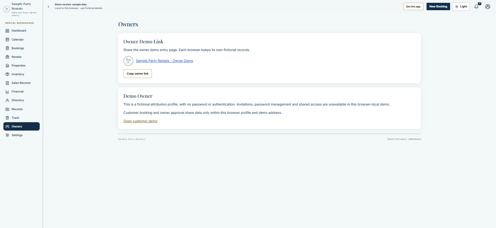](assets/screenshots/owners-overview.png)

## Settings

**Configure the app for your business.** Identity, appearance, future numbering, delivery, receipt paper, rental options, monthly billing and installation/update cards are shown in one zoomed-out overview. Demo-only Sample Records and Simulated Delivery cards are identified separately from the online provider controls.

[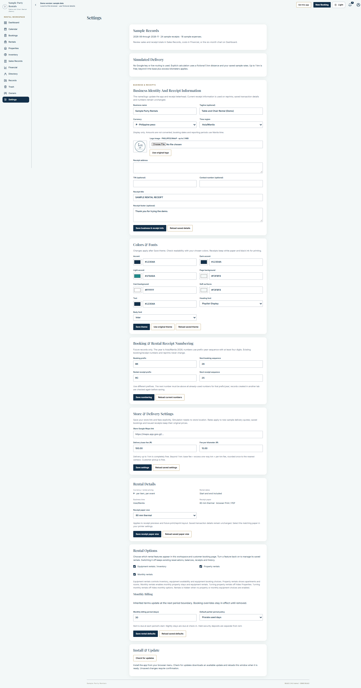](assets/screenshots/settings-overview.png)

## Explore the workflows

Use the [Wiki workflow guide](https://github.com/David-debug2/Rental-Management-Web-App-docs/wiki/Rental-Workflows) for the ordinary booking journey, or [Getting Started](https://github.com/David-debug2/Rental-Management-Web-App-docs/wiki/Getting-Started) to prepare a workspace. Full setup guides and the development source accompany the [commercial source product](https://ko-fi.com/projectdavid). Public documentation shows capabilities and usage at an overview level.
